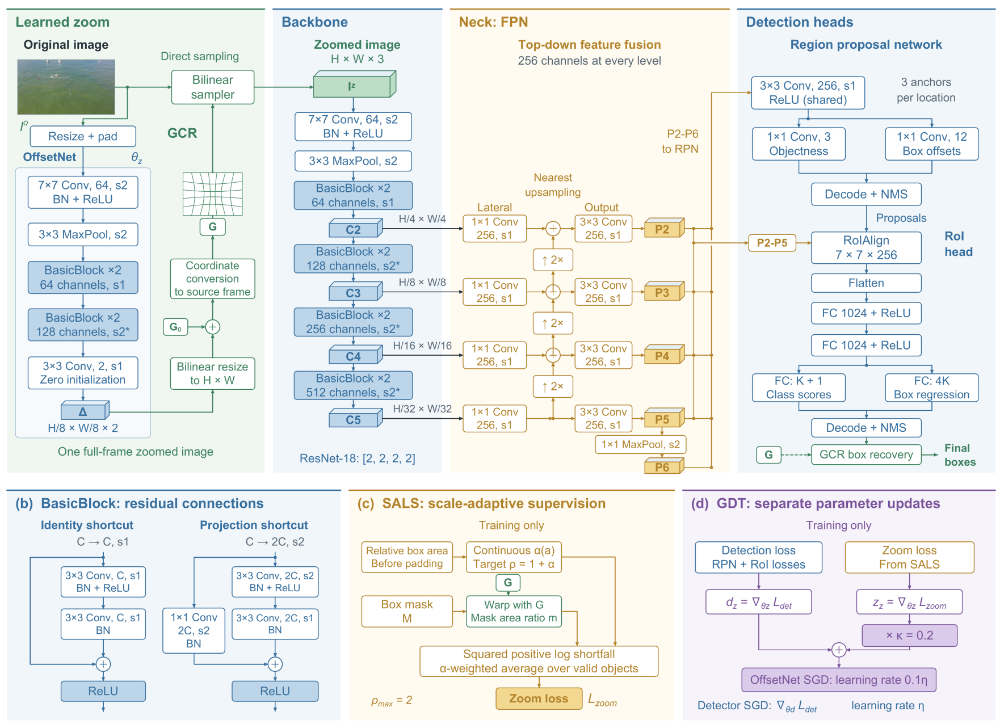

# SGCZoom

## Scale-Guided and Geometry-Consistent Non-Uniform Zooming for UAV Small-Object Detection

> **Code release pending paper acceptance.** The full source code, training and evaluation configurations, and reproduction instructions will be made publicly available in this repository after the paper is accepted.
>
> **开源说明：完整源码、训练与评估配置以及复现说明将在论文接受后在本仓库公开。当前仅保留项目整体框架和说明，暂不提供核心算法实现。**

SGCZoom is a zoom-and-detect framework for small-object detection in UAV imagery. The project studies how to allocate image resolution to informative regions while maintaining geometric consistency during detection.

### Architecture overview



### Framework overview

- **Geometry-Consistent Resampling (GCR):** consistent geometry across image resampling, annotation transformation, and prediction mapping.
- **Scale-Aware Layered Supervision (SALS):** scale-aware guidance for the zoom branch.
- **Gradient-Decoupled Training (GDT):** coordinated optimization of the zoom branch and detector.

The intended detection stack is PyTorch and MMDetection. The project considers the VisDrone and SeaDronesSee benchmarks.

### Current availability

This is a project framework and documentation preview. Core model code, custom runtime modifications, algorithm-specific configuration files, tests, training and evaluation scripts, and packaged source distributions are withheld until paper acceptance. This preview cannot be used to install, train, evaluate, or reproduce SGCZoom.

### Repository structure

```text
.
├── configs/                 # Configuration location for the future release
│   └── _base_/
├── sgczoom/                 # Source package location for the future release
│   ├── datasets/
│   └── models/
├── tools/                   # Training and evaluation entry points (pending)
├── scripts/                 # Supporting utilities (pending)
├── tests/                   # Validation and regression tests (pending)
├── docs/
│   ├── FRAMEWORK.md
│   └── DATASETS.md
├── CITATION.cff
├── LICENSE
└── README.md
```

### Release plan

After paper acceptance, this repository will be updated with:

- The full SGCZoom implementation.
- Dataset preparation instructions and experiment configurations.
- Installation, training, evaluation, and reproduction instructions.
- Validation and regression tests.

### Datasets

Dataset images and annotations are not redistributed here. See [dataset notes](docs/DATASETS.md).

### Citation

Paper citation and publication details will be added after acceptance.

### License

The materials currently included in this repository are covered by [Apache License 2.0](LICENSE). Licensing and attribution for any third-party components will be documented when the implementation is released.
